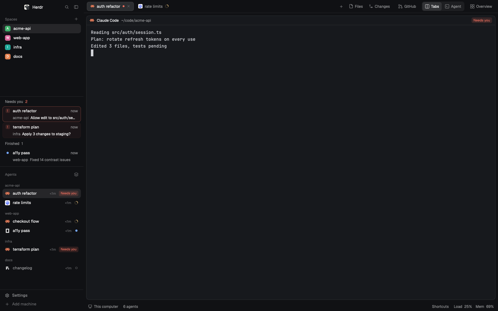
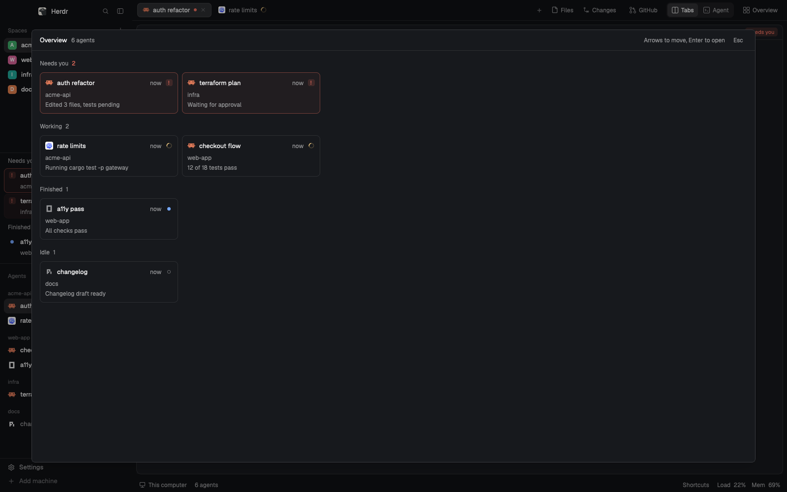
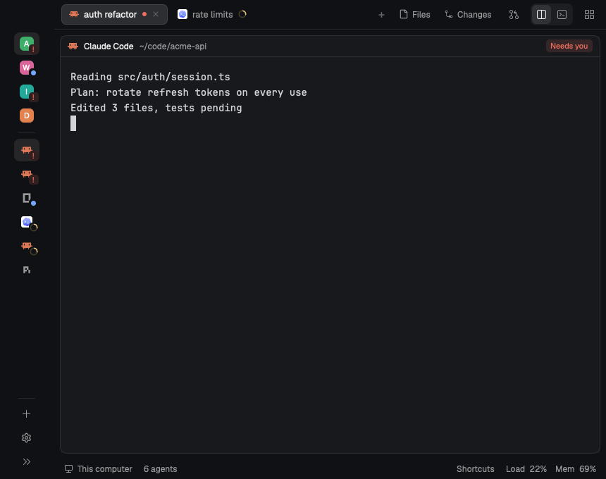
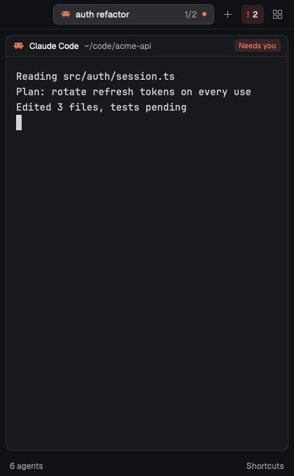
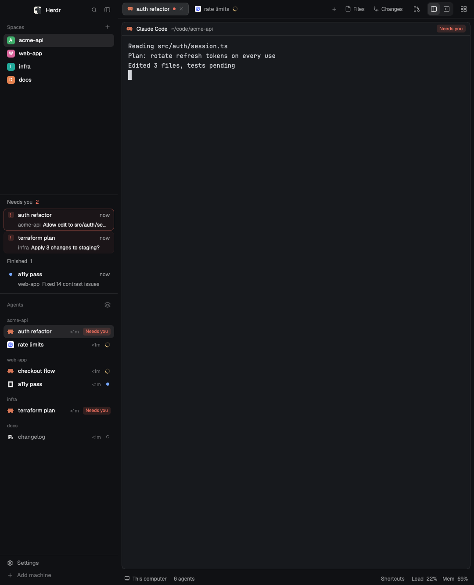

# Homestead

A clean, responsive layout for the [Herdr](https://herdr.dev) desktop app, built around one question: who needs me now? It keeps Herdr's own lists, tab bar and panels, follows your theme, and holds up from a 360px sliver to a wall display, on Retina and ordinary external monitors alike.



## Install

Paste this to your agent inside Herdr:

```
Read ~/.config/herdr-app/AGENTS.md, then add this layout: https://github.com/Yabuku-xD/herdr-homestead
```

Your agent reads every file first, adds the layout next to yours and switches to it. Switch back with `ctrl-shift-l` or your own layout key.

## Features

- **Needs you.** Blocked agents wait in one place, longest wait first, each with what it asked. Finished work sits under its own heading. It appears only when someone is waiting, between Spaces and Agents, so Spaces never move under your pointer.
- **Overview.** Every agent on every space at a glance, in bands by urgency, with the last line of each screen. Arrows move, Enter opens, Esc leaves. It is a dialog, so your typing never lands in a terminal you can't see.
- **One agent, full size.** Tabs and Agent are one switch. Anything that moves focus to a shell brings the tabs back.
- **GitHub panel.** Pull requests with their checks and issues for the focused terminal's repo. Start agent opens a worktree for an issue, with an agent told to read it.
- **Focus mode.** Hides the sidebar, panel and status bar. The way out stays on screen, and so does the count of who needs you.
- **Shortcuts.** One click in the status bar lists every action with its key, and each row runs it.
- **Sharp on any screen.** Every icon is drawn natively for each rendered size, and text snaps to whole pixels at any zoom, so 110% is as crisp as 100%, including on 1x monitors and 1080px portrait ones.
- **Quiet edges.** One surface and one card, with no stacked lines. Focus shows as a line under the pane header, only when a tab is split.
- **Yours to extend.** Add a block to the layout's `panel-body` and its button appears by itself. The breakpoints are two small tables at the top of `fit.js`.
- **Stays current.** Herdr's own mods are used as they are, never copied, so Herdr's updates keep reaching them.

## Every size

The window adapts as you resize it, and zoom counts as a smaller window. A sidebar you dragged stays yours until a breakpoint is crossed, and growing the window restores what was there.

| Width | Sidebar | Top bar | Side panel |
|---|---|---|---|
| 1240+ | open | labels | beside the terminals |
| 960+ | open | icons, named on hover | beside the terminals |
| 720+ | one-column rail | icons, named on hover | beside the terminals |
| 560+ | hidden | icons, plus who needs you | takes over the work area |
| under 560 | hidden | one tab pill | takes over the work area |

| Overview | Rail | Small | Portrait |
|---|---|---|---|
|  |  |  |  |

## Keys

These work only in this layout and replace nothing of yours.

| Key | Action |
|---|---|
| `cmd-shift-o` | Overview |
| `cmd-shift-a` | One agent, full size |
| `cmd-shift-j` | Next agent that needs you |
| `cmd-shift-z` | Focus mode |
| `cmd-shift-e` | Files |
| `cmd-shift-g` | Changes |
| `cmd-shift-i` | GitHub |

## What it runs

`hc read` while Overview is open. `sh` with `sysctl`, `vm_stat` or `/proc` for Load and Mem in the status bar. `gh pr list` and `gh issue list` while the GitHub panel shows, so that panel needs the [GitHub CLI](https://cli.github.com). It reads nothing outside your terminals and repos, and nothing else reaches the network.

Tried on macOS. [RECIPE.md](RECIPE.md) is the full brief to rebuild it from an empty folder.

## License

[Apache-2.0](LICENSE)
