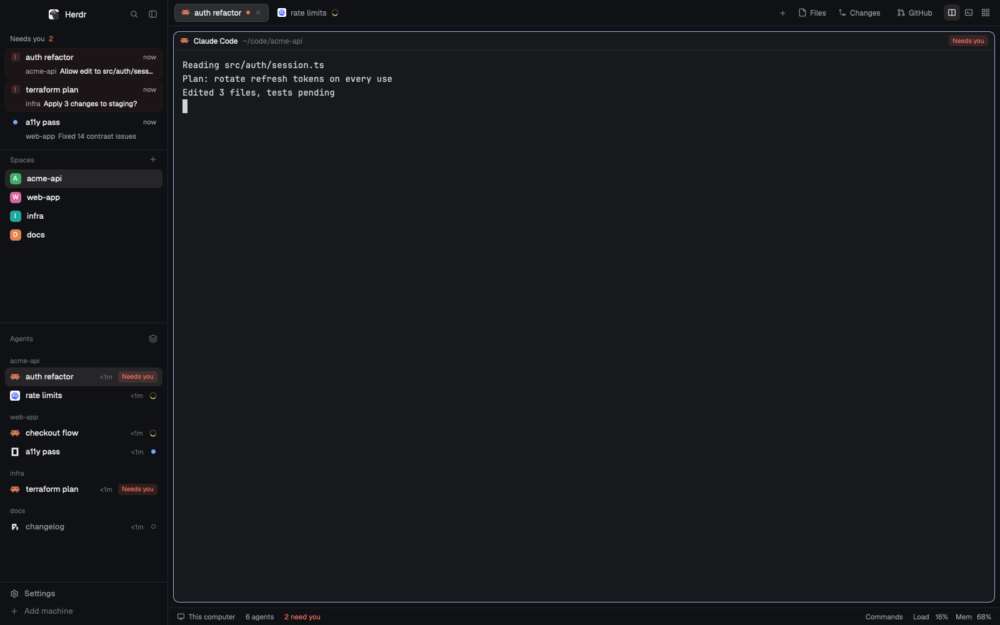

# Homestead

A clean, responsive Herdr window built around one question: who needs me now? A Needs you inbox sits at the top of the sidebar, one agent or the whole fleet can take over the work area, and the same window holds up from a 360px sliver to a wall display. It uses the person's own theme and keeps Herdr's own lists, tab bar and panels, so it follows every Herdr update.

## What you see

Left to right, on `chrome`, divider 1px `border`:

- **Sidebar** (268px, min 44, max 480):
  - **Brand** (46px, drags the window): shipped `workspace-chrome`.
  - **Inbox**, only while someone waits: header (31px, 11.5px `muted`, the blocked count in `blocked`), then rows 50px tall with 2px between, radius 8, inset 8. Each row: a 14px mark in a 16px column, the title (13px medium, `foreground`, on x=41 like the agents list), the wait (11px `muted`); under it the space and the agent's message. Blocked rows use the `alert.fill` tint and put the message in `foreground`. It shows up to 4 rows, then scrolls. 1px rule below.
  - **Spaces** and **Agents**: shipped `spaces` and `agents`, weights 2:3.
  - **Footer** (69px): shipped `workspace-chrome` with `footer`.
- **Work column**:
  - **Top bar** (42px): shipped `tabs`, then the bar: extra panels (26px high, 12px text, gap 3), a 10px gap, then the views as three 26px buttons: Tabs, Agent, Fleet. The bar's width is measured, so the 10px rhythm is exact at any font and zoom.
  - **Work body** (padding 8, gap 8): the view, then the panel.
    - **Tabs**: the active tab, panes radius 10, 1px `border`, `accent` on focus, 30px shipped `pane` header, a lone pane framed too.
    - **Agent**: one agent full size in the same frame, under a 30px header that matches the pane header.
    - **Fleet**: every agent in bands (Needs you, Working, Finished, Idle). Cards are 84px tall, at least 280px wide, gap 8, and the columns follow the width, one to six. Each card shows the program icon, name, time, mark, where it is and the last useful line of its screen.
    - **Panel** (368px, hidden at first): `files`, `changes` and `github` in a stack. GitHub has a 42px header like Files, two tabs (Pull requests, Issues), Refresh, and 50px rows.
  - **Status** (28px, 11.5px `muted`): machine, branch, `N agents`, `N need you` in `blocked`; at the right the palette key, Load and Mem.

Colors are theme names only, so every theme and both appearances work. Alpha lives in one place, `alert()` in `lib.js`.

## How it behaves

Status marks are the same 14px everywhere, with shape as well as color:

| Status | Mark |
|---|---|
| working | 12px spinner in `working` |
| blocked | 14px chip, radius 4, bold `!` |
| done | 7px dot in `done` |
| idle | 7px ring, 1.5px `idle` |

- **Inbox:** blocked first, longest wait first, then finished agents. A click focuses the agent and shows the tabs. Nobody waiting: the block hides.
- **Views:** Agent shows the focused agent, else the most urgent one. Anything that moves focus to a shell brings the tabs back, so input never lands on a pane nobody sees. Fleet: click opens the agent, right-click peeks at it.
- **Panels:** every child of `panel-body` beyond Files and Changes gets a button by itself, labeled from `props.panel`. A new panel is one block in the layout.
- **GitHub:** follows the focused terminal's folder, re-reads every 60s while shown. A row opens in the browser. An issue's Start opens the shipped worktree dialog with branch `issue-N` and the first installed agent, told to read the issue itself.
- **Zen:** hides the sidebar, panel and status; the top bar stays, so the blocked count does too.

The window adapts by width, measured in zoomed px, so zoom counts as a smaller window:

| Tier | Width | Sidebar | Top bar | Panel |
|---|---|---|---|---|
| full | 1200+ | open | labels | 368px beside the view |
| rail | 820+ | one-column rail | icons | 320px beside the view |
| solo | 560+ | hidden, `! N` pill | icons | takes over the work area |
| micro | under 560 | hidden, `! N` pill | one tab pill, `+`, a view stepper | takes over the work area |

And by height:

| Tier | Height | Inbox rows | Footer | Status |
|---|---|---|---|---|
| tall | 720+ | 4 | yes | yes |
| medium | 560+ | 3 | yes | yes |
| short | 400+ | 2 | no | yes |
| tiny | under 400 | 1 | no | no |

- A rule runs only when a breakpoint is crossed, so a sidebar you dragged stays yours.
- Going back up restores what was there: the sidebar width, the panel and its width.
- **Rail:** one center line. Every cell is 36×32, radius 8, status always in the bottom right corner. Space tiles first, then agents by urgency, then New space, Settings and Unfold. It shows whenever the sidebar is under 160px, by drag or fold as well as by tier.

Keys, scoped to this layout: `cmd-shift-a` Agent, `cmd-shift-o` Fleet, `cmd-shift-j` next who needs you, `cmd-shift-z` Zen, `cmd-shift-e` Files, `cmd-shift-g` Changes, `cmd-shift-i` GitHub.

## Built from

- `layouts/homestead.json`: no look of its own beyond `background: chrome`. Root `row` [`fit-y` 0px block, `shell` column [`fit-x` 0px block, `frame` row [`sidebar` column [`brand`, `inbox`, `sidebar-lists` column [`spaces`, `agents`], `rail`, `sidebar-footer`], `work` column [`topbar` row [`tabs`, `bar`], `work-body` row [`view` stack [`main`, `agent` column [`agent-head`, `agent-terminal`], `fleet`], `panel` column [`panel-body` stack [`files`, `changes`, `github`], `panel-spare` 0px]], `status`]]]].
- One mod, `mods/homestead/`, with `props.role`: `fit` (`axis` x or y), `inbox`, `rail`, `bar`, `fleet`, `agent-head`, `github`, `status`, `blank`. Helpers in `lib.js`. The breakpoints are the two tables at the top of `fit.js`.
- Shipped mods used as they are, never cloned: `workspace-chrome`, `spaces`, `agents`, `tabs`, `pane`, `files`, `changes`, `new-menu`, `worktree`.
- `herdr`: `agents`, `spaces`, `panes`, `terminals`, `focused`, `layout`, `shared`, `setShared`, `run`, `hc`, `exec`, `keys`, `knownAgents`, `nextCommand`, `notify`, `openOverlay`, `settings`, `theme`, `window`, `props`.
- Commands: `layout.show`, `layout.hide`, `layout.resize`, `layout.select`, `agent.focus`, `terminal.peek`, `tab.next`, `tab.prev`, `space.select`, `space.new`, `app.palette`, `app.settings`.
- Programs: `hc read` (Fleet, while shown), `sh` with `sysctl`, `vm_stat` or `/proc` (status, local), `gh pr list` and `gh issue list` (GitHub panel, read-only), `open` or `xdg-open` for a row. Nothing else reaches the network.
- Art: its own stroke icons in `mods/homestead/`, one 18×18 frame in a 24 box.
- `keys.json`: the `layout:homestead` section, nothing global.

## Watch out

- A layout has no media queries. The two 0px `fit` blocks are the measure: `fit-x` spans the window's width, `fit-y` its height. Divide what `on_size_change` reports by `settings().zoom`.
- Hidden blocks may not render, so nothing can show itself again. The bar is always shown, so it owns the inbox's size, the rail switch and the panel takeover. Only the bar calls `nextCommand()`.
- Herdr folds a container with one child when it saves a layout, losing its id. `panel-spare` keeps `panel` alive; the shipped tab bar finds `panel` and `panel-body` by id, so keep them.
- Panels missing from shared `workspace.panels` close on every space switch. The bar adds them.
- A window in the background doesn't repaint, and `herdr-app shot` then returns an old frame. Bring the window to the front before you judge a capture.
- `dim` measures under 4.5:1 for text on every theme (2.6 to 3.6 on `chrome`), so this mod's own text uses `muted` or `foreground`. The Agent header's space name stays `dim` to match the shipped pane header beside it. `alert.fill` is `blocked` at 0c, the strongest tint where `muted` holds 4.5:1 on every shipped theme; hover changes the edge, not the fill.
- First run only: if `agents.sort` is unset, the bar sets it to `grouped`, because the inbox owns urgency. That shared key also applies in other layouts; the list's own menu changes it back.
- Fleet takes no keyboard: while it shows, typing goes to the focused pane behind it.
- Agents' messages appear only if their program sends `msg` in its OSC 7501 report, base64 encoded. Otherwise rows read "Waiting for you" or "Finished".
- Times are the tab's, not the agent's: Herdr keeps no per-agent clock.
- Load is the load average per core, not a CPU percentage.
- On Linux and Windows the shipped tab bar draws its window buttons before the bar, not at the far right. Only macOS was tried.
- The rail's tile colors repeat the shipped spaces list's six values. If Herdr changes them, the rail differs until `TILE_FILL` is updated.
- Write `mod.json` before `main.js`, or Herdr docks the mod on the right. `herdr-app check` writes `gpui-kit.d.ts` and `jsconfig.json` into the folder; they are not part of the build.

## Done when

- `herdr-app check mods/homestead` passes, and `layout.switch {"name": "homestead"}` shows the window above with no errors in `herdr-app status`.
- A blocked agent appears in the inbox with its message, and disappears when answered. `cmd-shift-j` walks the queue.
- Resizing live through 1800, 1440, 1100, 860, 680, 480 and 360px gives the tiers above, with no clipped tab and no horizontal overflow, in Tabs, Fleet and with a panel open.
- Growing the window back restores the sidebar, the panel and their widths.
- `cmd-shift-z` hides the chrome, and pressing it again restores it.
- A new block in `panel-body` gets a bar button without touching code.
- 0, 1 and 60 agents, long, CJK, Arabic and emoji names, and a `<script>` tab name all render as plain text without breaking a row.
